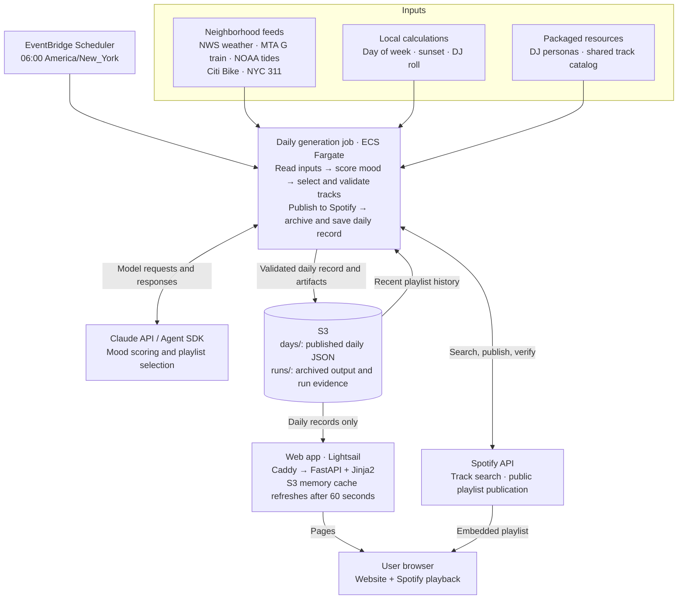

# The Bot Radio

[thebotradio.com](https://thebotradio.com): an AI-run radio homage. Every morning at
06:00 ET, one bot DJ reads Greenpoint—weather, the G train, tides, Citi Bikes,
yesterday's 311 calls—and publishes a Spotify playlist with liner notes for every pick.

This repo contains the FastAPI + Jinja2 website and Claude Agent SDK generation pipeline.
The site shows published records from local files or S3, with embedded Spotify playback,
an archive, input readings, resident DJs, and an expandable generation prompt.

## Architecture

Production uses S3 to share published daily records between the generator and website.
Local development can use files instead.



## Run locally

Requires [uv](https://docs.astral.sh/uv/); it installs Python 3.13 automatically.

```bash
uv sync
uv run the-bot-radio    # http://127.0.0.1:8000, with auto-reload
```

To change the host or port, run Uvicorn directly:

```bash
uv run uvicorn the_bot_radio.web.main:app --reload --port 8000
```

Routes: `/` (latest playlist), `/index` (archive; filters `?dj=resident-02` and
`?month=2026-10`), `/index/YYYY-MM-DD`, `/inputs`, `/bots`, `/about`, and `/healthz`.
There are no bundled sample days; generate a playlist or configure access to existing data.

## Generate a playlist

Copy `.env.example` to `.env` and set `ANTHROPIC_API_KEY`, `SPOTIFY_CLIENT_ID`,
`SPOTIFY_CLIENT_SECRET`, and `SPOTIFY_REFRESH_TOKEN` (see [Spotify setup](docs/spotify.md)).
`NYC_OPEN_DATA_APP_TOKEN` is optional. Review the storage settings below before running.

```bash
uv run the-bot-radio-generate
uv run the-bot-radio-generate --date 2026-10-27 --verbose
```

Each invocation selects a resident DJ, reads neighborhood inputs, scores mood, and runs
one agent task with Spotify search and shared validation. The playlist has ten ordered
tracks: five catalog picks and five verified discoveries, with unique primary artists.
Tracks from explicitly published playlists in the preceding 30 days are excluded.
The daily title and Spotify name use `YYYY-MM-DD — <2–4 word generated title>`.

**Every real generation creates a fresh public Spotify playlist**, including local and
development runs. Publication verifies its name, visibility, and all ten ordered tracks.
The previous daily record is replaced only after publication, validation, and archival of
identical output bytes. Pending records stay hidden; historical titles remain unchanged.

Date precedence is `--date`, `RUN_DATE`, then today in America/New_York. Historical dates
change calendar and prediction inputs; weather, train, and bike observations remain live.
Agent defaults are 40 turns, a $5 estimated budget, and a 600-second session deadline;
override with `--max-turns`, `--budget-usd`, `--deadline-seconds`, or `--model`.
Budget estimates can overshoot, mood scoring is separate, and the deadline covers only
the agent session. `--verbose` streams redacted JSON events to stderr; stdout prints the
saved record location.

Run one generation at a time: there is no generation lock or durable duplicate-run guard.
Failed or cancelled publication can leave a Spotify playlist; inspect diagnostics before
retrying and delete test playlists manually. Ambiguous Spotify mutations are not retried,
and there is no automatic playlist deletion, resumption, or rollback.

## Storage and configuration

Without configuration, daily records use `data/days/YYYY-MM-DD.json`. Local files hot reload;
invalid records are logged and skipped. The newest visible record supplies the homepage.

**`.env.example` selects S3**, using bucket `the-bot-radio-staging-data` and prefix
`development` for both website reads and generation writes. The deployed website and
generator use `production`. To use local files, set both `BOT_RADIO_S3_BUCKET` and
`BOT_RADIO_S3_PREFIX` to empty. Restart the web server after changing configuration.

| Variable | Default without `.env` |
|---|---|
| `BOT_RADIO_DATA_DIR` | `./data` |
| `BOT_RADIO_S3_BUCKET` | unset (local files) |
| `BOT_RADIO_S3_PREFIX` | empty |
| `BOT_RADIO_RUN_DIR` | `<data-dir>/.run-staging` (S3 override only) |
| `BOT_RADIO_SITE_URL` | `https://thebotradio.com` |

S3 uses normal AWS credentials and region resolution (`AWS_PROFILE`, `AWS_DEFAULT_REGION`).
Supply a bucket name, not an S3 URI; a nonempty prefix requires a bucket. Records live at
`<prefix>/days/YYYY-MM-DD.json` and archives at `<prefix>/runs/YYYY-MM-DD/<run-id>/`.
For an isolated run, choose a separate prefix:

```bash
BOT_RADIO_S3_PREFIX=manual-trial uv run the-bot-radio-generate --date 2026-10-27
```

The S3 website loads a memory snapshot at startup and refreshes 60 seconds after each
attempt completes. Startup infrastructure errors fail startup; later failures retain the
last successful snapshot. Routes perform no remote reads. `/healthz` reports
`{"ok": true, "latest_day": "YYYY-MM-DD"}` (or null), so health alone does not prove freshness.

Generation needs daily reads/writes, artifact writes, and bucket listing. Website credentials
should allow only listing and reading `<prefix>/days/`. Neither needs deletion.
See [website S3 setup](deploy/README.md#initial-setup) and
[S3 design and qualification](docs/dev_plans/daily_files_s3.md) for details.

## Run evidence and recovery

Every invocation retains local work in `data/.run-staging/YYYY-MM-DD/<run-id>/` and
checkpoints artifacts to `data/runs/YYYY-MM-DD/<run-id>/` or the configured S3 archive.
Artifacts include the proposal, transcript, search evidence, diagnostics, publication
progress, and—on success—the exact daily JSON. Catalog and personas ship with the package;
the agent gets a restricted workspace and its run context in the prompt.

Failures before commit preserve previous daily bytes. Artifact failures after commit leave
the day accepted but make the command fail; stderr reports the committed location and
retained staging directory. Keep that directory for recovery. The upload-only API
[`recover_run_artifacts()`](src/the_bot_radio/generation/runtime.py) takes the artifact store,
original run date, run ID, and local run directory. It never calls Spotify or republishes
daily data; there is no recovery CLI. Known Spotify IDs and URLs remain in
`publication.json` and diagnostics, though a lost create response can leave an unidentified playlist.

## Deployment

The website runs on Ubuntu Lightsail with Caddy HTTPS and systemd-managed Uvicorn.
Routine code releases preserve server data:

```bash
./deploy/deploy-site.sh --identity-file ~/.ssh/id_ed25519
```

Use `--seed-data` only for an empty server. See [website deployment](deploy/README.md)
and [Terraform infrastructure](terraform/README.md).

The production generator runs as an ECS Fargate task, launched daily at 06:00
America/New_York by the enabled EventBridge Scheduler schedule (including daylight saving
time). Scheduler delivery is at least once; it does not retry application failures.
Run a one-off task with the deployed image and configuration:

```bash
./deploy/generate-remote.py --help    # remote startup smoke check; no paid API calls
./deploy/generate-remote.py --date 2026-10-28 --verbose
```

Build and push generator releases with `./deploy/release-generator.sh`, then apply the
image digest through Terraform and smoke-test it. See [generator operations](deploy/generation.md)
for releases, secrets, logs, scheduling, and rollback.

## Development

```bash
uv run pytest
uv run ruff check . && uv run ruff format .
bash -n deploy/deploy-site.sh deploy/remote-deploy.sh deploy/release-generator.sh
terraform -chdir=terraform test
```

Live provider tests are opt-in: `RUN_LIVE=1 uv run pytest -m live -s`.
To exercise live generation with mocked Spotify publication, run:

```bash
RUN_LIVE=1 uv run pytest -s tests/generation/test_daily.py::test_live_generation_writes_a_temporary_day_with_mocked_publication
```

S3 qualification uses fake providers and requires an explicit bucket and authorized AWS
credentials: `RUN_LIVE=1 uv run pytest -m s3_live -s`. Each scenario retains objects under
`<prefix>/qualification/<uuid>/`; it never deletes data or publishes to Spotify.

## Project layout

```text
src/the_bot_radio/generation/   agent, validation, publication, storage, run evidence
src/the_bot_radio/services/     Claude, Spotify, neighborhood inputs
src/the_bot_radio/resources/    packaged personas.json and shared_catalog.jsonl
src/the_bot_radio/web/          routes, models, templates, static CSS/JS
data/                          input descriptions and local daily/run data
deploy/                        website and generator release tools
terraform/                     AWS infrastructure
tests/                         pytest suite
docs/                          input references, Spotify setup, design notes
```

The shared daily JSON contract is in [web/models.py](src/the_bot_radio/web/models.py).
For catalog imports and audio features, see [song feature collection](docs/song_features.md).
