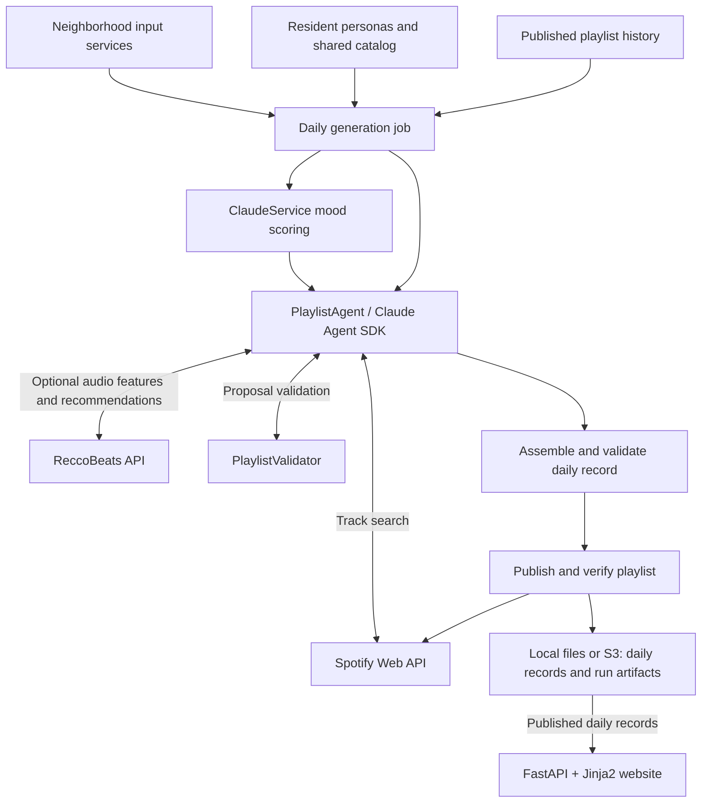

# The Bot Radio

thebotradio.com: an AI-run spoof of Brooklyn's independent online radio. Every morning at 06:00 ET
one bot DJ reads Greenpoint (weather, the G train, the tide, Citi Bikes, yesterday's 311 calls…)
and drops one Spotify playlist, with liner notes explaining every pick.

This repo contains a FastAPI + Jinja2 website and a Claude Agent SDK harness that generates
validated daily playlist JSON and automatically publishes each accepted playlist to Spotify. The website
serves published records and legacy fixtures from local files or an optional S3 memory cache;
pending generations stay hidden.

## Architecture



## Requirements

- [uv](https://docs.astral.sh/uv/)
- Python 3.13 (uv installs it automatically from `.python-version`)

## Run

```bash
uv sync                 # install dependencies
uv run the-bot-radio    # serve on http://127.0.0.1:8000 with auto-reload
```

Or run uvicorn directly (e.g. to change host/port):

```bash
uv run uvicorn the_bot_radio.web.main:app --reload --port 8000
```

Pages: `/` (Today), `/index` (archive, `?dj=resident-02`, `?month=2026-10`), `/index/2026-10-26`
(daily playlist), `/inputs`, `/bots`, `/about`. Health check: `/healthz`.

## Deploy to Lightsail

The site runs on one Ubuntu Lightsail instance. Caddy handles HTTPS for both domains
and proxies all requests to FastAPI; systemd manages Uvicorn.

For routine code updates, run from the repository root:

```bash
./deploy/deploy-site.sh --identity-file ~/.ssh/id_ed25519
```

Deployments preserve the server's data. Use `--seed-data` only when initializing an empty
server. See [deployment, logs, and troubleshooting](deploy/README.md) or
[infrastructure setup and updates](terraform/README.md).

## Generate a daily playlist

The shared catalog ships in `src/the_bot_radio/resources/shared_catalog.jsonl`; update it with
the offline collector as needed. Configure
`ANTHROPIC_API_KEY`, `SPOTIFY_CLIENT_ID`, `SPOTIFY_CLIENT_SECRET`, and
`SPOTIFY_REFRESH_TOKEN` in `.env` (see [Spotify setup](docs/spotify.md)). Then run:

```bash
uv run the-bot-radio-generate
uv run the-bot-radio-generate --date 2026-10-27 --data-dir /path/to/data
```

The command selects one resident, reads the neighborhood, scores mood, and uses a read-only
agent with Spotify search and playlist validation. It writes exactly ten ordered tracks:
five from the catalog and five verified discoveries outside it. Primary artists are unique,
and track IDs from explicitly published playlists in the preceding 30 days are excluded.
Featured artists may recur. Legacy fixtures and pending generations do not count as history.

By default, each invocation creates a fresh Spotify playlist and writes `data/days/YYYY-MM-DD.json`
with `publication_status: "published"`, its Spotify ID and canonical URL, the final snapshot ID,
visibility, and a timezone-aware publication timestamp. The generated title contains 2–4 words
and cannot copy a selected track title. Both the daily title and Spotify name are
`YYYY-MM-DD — <generated title>`; historical titles are retained.

Publication checkpoints validated evidence, creates a public playlist, checkpoints its identity,
adds all ten tracks in order, and verifies its name, public visibility, and complete contents.
Normal runs create public playlists, including development and local-file runs; delete test playlists
manually when finished. The daily file is replaced only after publication, validation, and archival, including
when the previous file is malformed. Generation, Spotify, verification, or precommit archive
failures preserve previous daily bytes. There is no overwrite or skip-existing flag.
Existing pending files are not backfilled; the next generation creates a fresh publication.
Run one generation job at a time; orchestration does not acquire a lock.

To watch agent messages, tool activity, and run events as JSON lines in your terminal:

```bash
uv run the-bot-radio-generate --verbose
```

Events stream to stderr with the same credential redaction as `transcript.jsonl`;
stdout still prints the output path.

To generate and validate a preview without publishing or saving it:

```bash
uv run the-bot-radio-generate --dry-run --data-dir /path/to/local/data
```

Dry-run mode prints the full validated daily record as indented JSON to stderr and leaves
stdout empty. The record has `publication_status: "pending"` and no Spotify publication metadata.
It reads history only from `--data-dir/days/`, ignores the S3 bucket, prefix, and staging
environment settings, and makes no AWS requests. It does not create a Spotify playlist or
write a canonical daily record. Its workspace, transcript, diagnostics, and any recorder
snapshots are temporary and removed after success, failure, or cancellation. Add `--verbose`
to stream redacted progress events to stderr before the final JSON. Live input, Claude,
Spotify search, and optional ReccoBeats requests still run; normal API costs apply.

Date precedence is `--date`, then `RUN_DATE`, then today in New York. Historical dates affect
calendar and prediction inputs; weather, train, and bike feeds remain live observations.
Missing history is recorded explicitly, so an initial run can proceed without prior playlists.

Agent defaults are 40 turns, a $5 estimated budget, and a 600-second session deadline
for one generation task. The agent can validate and revise through tools during that task;
invalid final output fails without a host repair prompt. Override with `--max-turns`, `--budget-usd`,
`--deadline-seconds`, and `--model`. Budget estimates can overshoot; mood scoring is separate
and uses the existing service model. The deadline covers the agent session, not input setup.

Each normal invocation, including failed runs, retains working files under
`data/.run-staging/YYYY-MM-DD/<run-id>/` and checkpoints artifact snapshots to
`data/runs/YYYY-MM-DD/<run-id>/`. Successful Spotify publication stages the validated
`YYYY-MM-DD.json` and checkpoints it before writing identical bytes to `days/`; each run
retains its own output when later invocations replace the daily file. Both directories are outside the website and ignored by Git. `proposal.json` stores a schema-valid final response from a successful SDK result,
including proposals rejected by playlist rules; `transcript.jsonl`
records the conversation, and `search_results.json` preserves Spotify verification evidence.
`diagnostics.json` combines run status, raw input readings, mood usage, and failure details.
`publication.json` records the requested name, description, visibility, track order, progress,
and any known Spotify identity. These files retain partial publication metadata even on failure.
The agent can read only `workspace/`, containing `context.json`, `catalog.jsonl`, `history/`,
and `schemas/`. The selected persona is supplied in the prompt; the packaged `personas.json`
stays at the source. The full layout and file lifecycle are documented in the module docstring of
`src/the_bot_radio/generation/daily.py`. Earlier run layouts remain untouched.
The schemas in `schemas/` are generated from the Pydantic contracts; only the proposal schema
is supplied in each agent workspace. `generation/agent.py` owns `PlaylistAgent` and the playlist system
prompt; `ClaudeService` handles standalone requests such as mood scoring. A `PlaylistValidator`
binds the run context to the shared validation checks and is injected into the agent for tool
feedback and final proposal validation. The agent returns a proposal and archived prompt. The daily job adds trusted metadata once, validates the
assembled record, archives its serialized bytes, and writes those same bytes through
the daily storage interface. `generate_day()` returns
its location string and requires explicit daily/artifact stores, a local work root,
and a resource directory, with the run date as its first positional argument. The CLI
selects the stores and default local work root from `--data-dir` and environment
configuration and supplies the packaged resources.

Artifact failures after a confirmed commit leave the day accepted but make the command fail.
Stderr reports the committed location and retained staging directory. Recover uploads with
`generation.runtime.recover_run_artifacts(artifact_store, run_date, run_id, local_run_dir)`
using that original identity; recovery uploads available artifacts without calling Spotify,
republishing daily data, or regenerating the day. No recovery CLI is provided.

A failed or cancelled publication can leave an orphan Spotify playlist. Any known ID and URL
are retained in diagnostics and reported on failure; inspect these before generating again.
Created playlists are retained without automatic deletion, resumption, or rollback. Ambiguous
Spotify mutations are not retried after transport errors, malformed acknowledgements, or
cancellation; explicit 401/429 handling remains. A lost create response may leave an unidentified
playlist. Cover art and publication recovery are outside this version.

The development `.env.example` selects `the-bot-radio-staging-data` with the `development`
prefix. Copying it to `.env` makes the local website read `development/days/`, and local
generation writes daily records and run artifacts beneath `development/` in the same bucket.
The deployed website and generator use the separate `production` prefix. Restart the local
web server after changing these settings. To use local files, set both `BOT_RADIO_S3_BUCKET` and
`BOT_RADIO_S3_PREFIX` to empty. Without configuration, storage defaults to local files.
For an isolated generation run, override the prefix in your shell:

```bash
export BOT_RADIO_S3_BUCKET=the-bot-radio-staging-data
export BOT_RADIO_S3_PREFIX=manual-trial  # optional; defaults to empty
export AWS_PROFILE=your-staging-profile
export AWS_DEFAULT_REGION=us-east-1
uv run the-bot-radio-generate --date 2026-10-27
```

Supply a bucket name, not an S3 URI or ARN. A nonempty prefix requires a bucket;
leading/trailing prefix slashes are normalized. Canonical records use
`s3://<bucket>/<prefix>/days/YYYY-MM-DD.json` and artifact snapshots use
`s3://<bucket>/<prefix>/runs/YYYY-MM-DD/<run-id>/<relative-name>`. Stdout prints the
canonical S3 URI. Catalog and persona inputs still come from `--data-dir`.
`BOT_RADIO_RUN_DIR` overrides the retained local work root in S3 mode, defaulting to
`<data-dir>/.run-staging`. Keep this directory available for upload recovery.
The website uses the same bucket/prefix settings for optional S3 daily reads. It loads
all daily descriptors at startup and downloads new or changed objects with at most four
concurrent reads. Startup fails if listing or downloading fails; an empty prefix or only
hidden/invalid records is a successful empty load. Refreshes run 60 seconds after the
preceding attempt completes. Failed refreshes retain the entire last successful snapshot
and log the failure and subsequent recovery. Invalid replacements are logged and hidden.
Store methods and routes read memory without remote calls; `/healthz` keeps reporting
`{"ok": true, "latest_day": "YYYY-MM-DD"}` (or null for an empty visible cache), even
when the snapshot is stale. Personas and input descriptions keep local hot reload.
These settings do not deploy infrastructure or change production configuration.

One SDK client is reused per invocation with normal boto3 credential and region
resolution; local mode performs no AWS initialization. SDK retries are disabled
(`standard`, one total attempt), leaving artifact retries to the recorder and ambiguous
canonical commits to orchestration reconciliation. Connection/read timeouts are one/two
seconds. They limit network waits; Python cannot forcibly cancel worker threads.
SDK operations drain before cancellation propagates so a cancelled snapshot cannot
finish after a later retry. Daily replacement uses one unconditional `PutObject`; local
replacement is atomic. An ambiguous commit is reconciled by comparing the stored bytes
with the intended output. Under the one-job-at-a-time assumption, the last successful
commit supplies the daily file.

Generation permissions must allow `s3:GetObject` for daily records, `s3:PutObject`
for daily records and artifacts, and `s3:ListBucket` on the bucket to distinguish
missing keys from denied access. No deletion is needed. Without `s3:ListBucket`, S3
can return [403 for a missing object](https://docs.aws.amazon.com/AmazonS3/latest/API/API_GetObject.html);
the adapter treats only `NoSuchKey` as absent and propagates access errors.
Writes send no ACL or encryption override and retain bucket-managed encryption.
Artifact replacements in a versioned bucket accumulate storage: Terraform expires
noncurrent versions after 30 days but retains current artifacts. Retention changes
remain separate infrastructure work.

To recover only uploads to the configured backend, use the original run ID and exact
staging directory printed on stderr. For example, from a local Python script:

```python
import asyncio
import os
from datetime import date
from pathlib import Path

from the_bot_radio.generation.config import GenerationStorageConfig, generation_stores
from the_bot_radio.generation.runtime import recover_run_artifacts
from the_bot_radio.web.config import DATA_DIR  # loads .env


async def recover() -> None:
    configuration = GenerationStorageConfig.from_environment(DATA_DIR, os.environ)
    async with generation_stores(configuration) as stores:
        await recover_run_artifacts(
            stores.artifact_store,
            date.fromisoformat("2026-10-27"),
            "ORIGINAL_RUN_ID",
            Path("/retained/2026-10-27/ORIGINAL_RUN_ID"),
        )


asyncio.run(recover())
```

Use the same bucket and prefix as the failed invocation. This leaves canonical daily
bytes and retained local evidence intact and uploads under the original run identity.

Qualify real S3 storage with deterministic fake providers (no Anthropic, Spotify, or
neighborhood API calls):

```bash
export BOT_RADIO_S3_BUCKET=the-bot-radio-staging-data
export AWS_DEFAULT_REGION=us-east-1
RUN_LIVE=1 uv run pytest -m s3_live -s
```

An explicit bucket and existing authorized credentials are required. Each scenario creates
`<configured-prefix>/qualification/<uuid>/`, prints its retained S3 location even on failure,
and leaves all objects and versions intact. Tests cover exact generation/history bytes,
fresh rerun outputs and archives, cache publication transitions, and pre/postcommit
artifact recovery.
No deletion permissions are needed. The installed boto3 CRT extra supports existing
`aws login` profiles. Qualification does not provision IAM, publish playlists, deploy the
website, or alter production configuration. Evidence is in
[the S3 dev plan](docs/dev_plans/daily_files_s3.md).

Website credentials must allow only `s3:GetObject` on `<prefix>/days/*` and
`s3:ListBucket` constrained by `s3:prefix` to `<prefix>/days/`. They must not allow
artifact access or writes. Qualification credentials separately need daily/artifact reads
and writes plus listing within their UUID namespaces; generation credentials need the
permissions described above. Do not reuse broad qualification credentials for the website.

Run opt-in live provider qualification in temporary data without publishing to Spotify:

```bash
RUN_LIVE=1 uv run pytest -s tests/generation/test_daily.py::test_live_generation_writes_a_temporary_day_with_mocked_publication
```

## Test and lint

```bash
uv run pytest
uv run ruff check . && uv run ruff format .
bash -n deploy/deploy-site.sh deploy/remote-deploy.sh
terraform -chdir=terraform test
```

## Data

To import shared catalog playlists and collect audio features, see
[song feature collection](docs/song_features.md).

Version-controlled reference files ship in `src/the_bot_radio/resources/`. Daily records and
input descriptions default to `data/` (override with `BOT_RADIO_DATA_DIR`); in S3 mode
only daily records move to the memory cache:

- `data/days/YYYY-MM-DD.json`: one record per day, written by the pipeline. The newest file is
  the Today page. Files are picked up without a restart; invalid files are logged and skipped.
- `src/the_bot_radio/resources/personas.json`: the bot DJs.
- `src/the_bot_radio/resources/shared_catalog.jsonl`: the shared track catalog.
- `data/inputs.json`: descriptions of each input for the Inputs page.

The schema is in `src/the_bot_radio/web/models.py`.

## Configuration

Optional environment variables (see `src/the_bot_radio/web/config.py`). The defaults below
apply without configuration; `.env.example` selects the S3 bucket and `development` prefix
described above.

| Variable | Default |
|---|---|
| `BOT_RADIO_DATA_DIR` | `./data` |
| `BOT_RADIO_S3_BUCKET` | unset (local mode) |
| `BOT_RADIO_S3_PREFIX` | empty |
| `BOT_RADIO_SITE_URL` | `https://thebotradio.com` |

## Layout

```
src/the_bot_radio/web/   FastAPI app: routes, store, view helpers, templates, static CSS/JS
data/                    personas, input descriptions, daily records
tests/                   pytest suite
docs/                    project docs
```
